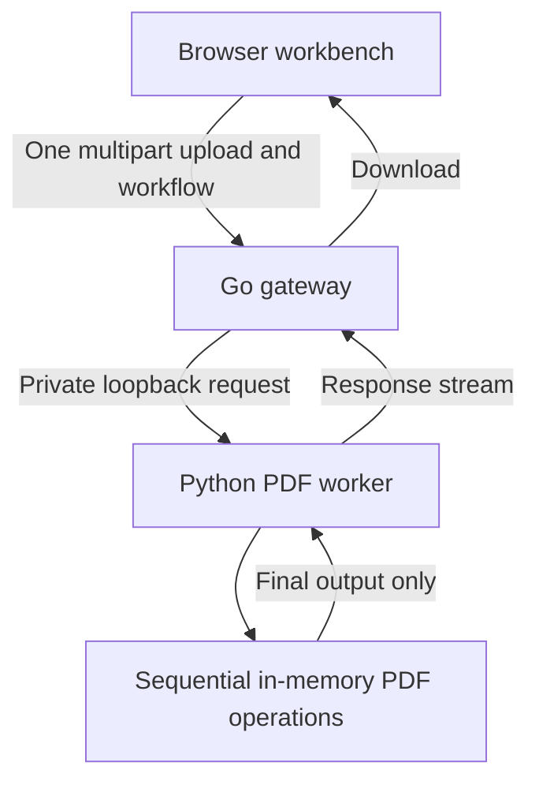

# Papertrail composable processing architecture

This is the development direction supplied by the project owner on 2026-11-06.
The [reference image](docs/architecture/reference.jpeg) calls it the “Prism
Composable Engine”. Papertrail remains the current product name. The image is
a design brief, not evidence of measured performance or competitor behavior.

## Intended execution model

- Go 1.22+ owns the public HTTP API, input limits, host/origin validation,
  worker lifecycle, readiness, and response forwarding.
- Python owns PDF processing and validates every operation and its options.
  The worker binds to loopback; it must not be independently exposed.
- A composed workflow uploads once, passes intermediate PDF bytes between
  allowed operations, and returns one final file. A failed step aborts the job.
- Documents and intermediate results must not become a durable job archive.
  Resource limits, cancellation, cleanup and error responses remain necessary.
- The frontend stays simple, responsive and sans-serif. Keep the existing API
  contracts and working tools while implementing this architecture.

## Current implementation and gaps

| Requirement | Current evidence | Remaining work |
| --- | --- | --- |
| Go gateway + Python worker | `main.go` starts a private worker and forwards API requests | Local Go startup already supports this; current Vercel deployment and Dockerfile run Python directly |
| One upload for multiple operations | `run_batch` in `app/pdf_tools.py` supports 1–10 allowlisted PDF-to-PDF steps | Preserve one request/one result; this is byte-buffer composition, not constant-memory processing |
| Streaming transport | Gateway uses a pipe for the worker request and copies the worker response | PDF engines still materialize inputs and outputs; do not describe the entire engine as streaming |
| Zero temporary document writes | Processing commonly uses byte buffers | Go multipart parsing spills above 8 MiB; Python upload buffering may also spill. PDF/A helper uses a temporary directory and is excluded from the public catalog |
| One-click instant export | Processing produces a downloadable response | Current UI requires a separate download click; automatic download remains a planned behavior |
| Idle RAM below 50 MB | Not measured | Measure the combined Go and Python process tree, including native libraries; report actual results |
| Cold startup below 1 second | Not measured | Measure process launch to successful gateway `/health`, with the worker ready |

The screenshot's Stirling-PDF numbers are unverified comparisons. Do not copy
them into marketing, documentation or tests as established facts.

## Implementation sequence and acceptance criteria

1. Package the existing Go gateway and Python worker together for a container
   or persistent server. Keep the Python-only Vercel adapter explicitly separate.
   Verify public-port readiness, worker restart/failure behavior, shutdown and
   existing API routes before moving the deployed service.
2. Design bounded, memory-only multipart ingestion at both gateway and worker.
   Admission control must apply before buffering large bodies, not just during
   PDF processing. Preserve size/file-count limits, reject malformed input and
   clean up on cancellation. Do not merely increase spool thresholds and call
   the result memory-safe.
3. Audit each exposed operation for temporary files and native-library writes.
   Prove zero document writes using filesystem tracing with uploads above both
   existing spool thresholds, failed jobs, and concurrent jobs. Until then,
   retain the truthful temporary-buffering disclosure in the README and UI.
4. Add opt-in or clearly labelled automatic export after successful processing.
   Preserve an accessible manual download link for blocked browser downloads.
5. Benchmark a built release binary plus worker on a recorded machine/container.
   Report OS, CPU, RAM, versions, dependency installation state, process-tree
   idle RSS, peak RSS, input sizes/page counts, concurrency and startup samples.
   Separate cold host startup from warm request latency. Publish measured
   median/p95 values and failures; do not treat targets as guaranteed results.

## Deployment and verification rules

- Preserve `main`; use a feature branch and reviewable commits.
- Existing hosted limits are 4 MiB combined input and 4 MiB output. Local input
  is 80 MiB. Changing architecture must not silently remove those protections.
- Run Go gateway tests and Python operation/API tests for runtime changes.
  Verify a real upload → multi-step workflow → download and inspect the result.
- Test input rejection, concurrent uploads, cancellation, unavailable workers,
  malformed PDFs, encrypted PDFs, output limits and error cleanup.
- Keep the architecture status honest: a documentation commit does not make
  unimplemented requirements operational and does not change the live deployment.
